<p align="center">
  
</p>

<h1 align="center">Meeting Island</h1>

<p align="center"><b>A live meeting transcript that sits under your camera.<br>Offline. English, Hindi and Hinglish. No cloud, no API.</b></p>

<p align="center">
  <a href="showcase/video/meeting-island-tour.mp4">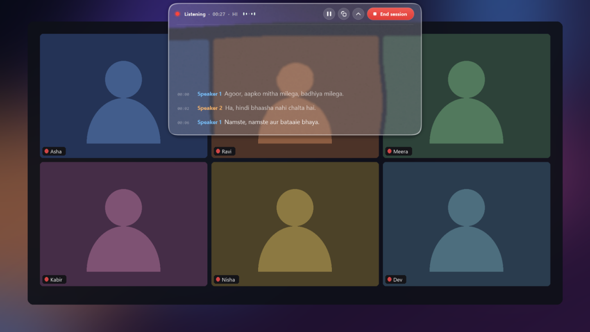</a><br>
  <b><a href="showcase/video/meeting-island-tour.mp4">&#9654; Watch the 6-minute tour</a></b> &nbsp;·&nbsp;
  <a href="docs/JOURNEY.md">How it was built</a> &nbsp;·&nbsp; <a href="docs/FEATURES.md">Every feature</a>
</p>

Meeting Island listens to what your PC is playing (a call, a video) or to the room microphone, and writes the meeting down while it
happens: a floating glass island at the top of the screen, a timestamped `.txt` when you press End. It runs entirely on an ordinary
laptop (no GPU), is built to be installed by double-clicking one file, and keeps improving after the meeting: a final pass listens to
the recording again and tells who said what, and the app learns from the corrections you make to the saved file.

> The source code is open (MIT). **No real meeting data is included**: the demo audio is public speech data (credits below), and the
> screenshots and film use a made-up desktop and invented names. The speech models are downloaded, not stored here.

## Highlights

- **Live, offline transcription** of English, Hindi and Hinglish, with grey drafts that settle at each pause (final text about 1 s
  after a pause in English, 2 s in Hindi), on a CPU.
- **Hinglish accuracy that was measured, not guessed:** 80 real clips with human transcripts took the first version from 70% of words
  wrong to about 30% (24% in conversation) by fusing a Hinglish Whisper model with AI4Bharat's Hindi IndicConformer.
- **Who said it:** voice prints for live labels; an offline diarization + clustering pass after the meeting (91% of lines on the right
  speaker in fast back-and-forth, against 80% live). Names can come from the screen: the ring a call app draws around the speaker.
- **A final pass** that replaces the live text with a more careful one, runs at low priority and waits for a charger.
- **It learns from your corrections:** fix a word in the saved `.txt`, and the next meeting spells it right.
- **A glass island** with spring physics: circle while dragged, vertical bar at an edge, Frost or Liquid look.
- **Made for a non-technical user:** one-file installer, small verified updates that roll themselves back on failure.

## Screenshots

<table>
<tr>
<td width="50%">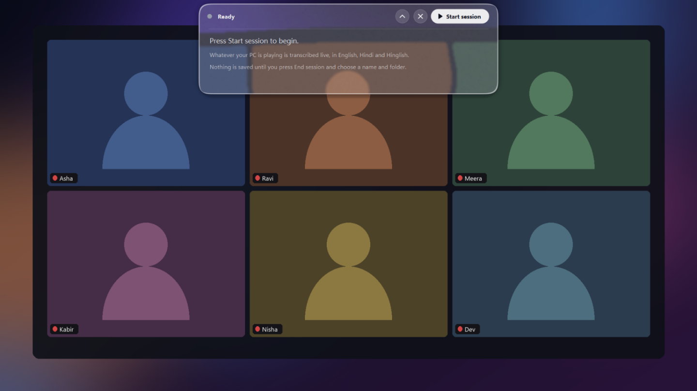<br><b>Ready: it lives under the camera, nothing listens yet</b></td>
<td width="50%">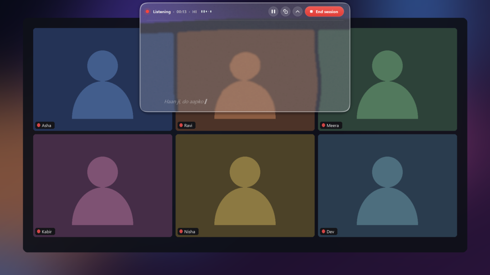<br><b>Live: grey drafts appear as the person speaks</b></td>
</tr>
<tr>
<td><br><b>Voices told apart, each with a colour</b></td>
<td>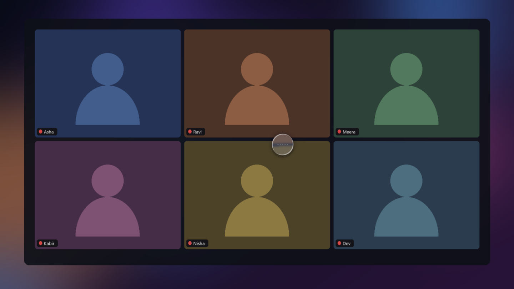<br><b>Held and dragged, the island becomes a circle</b></td>
</tr>
<tr>
<td>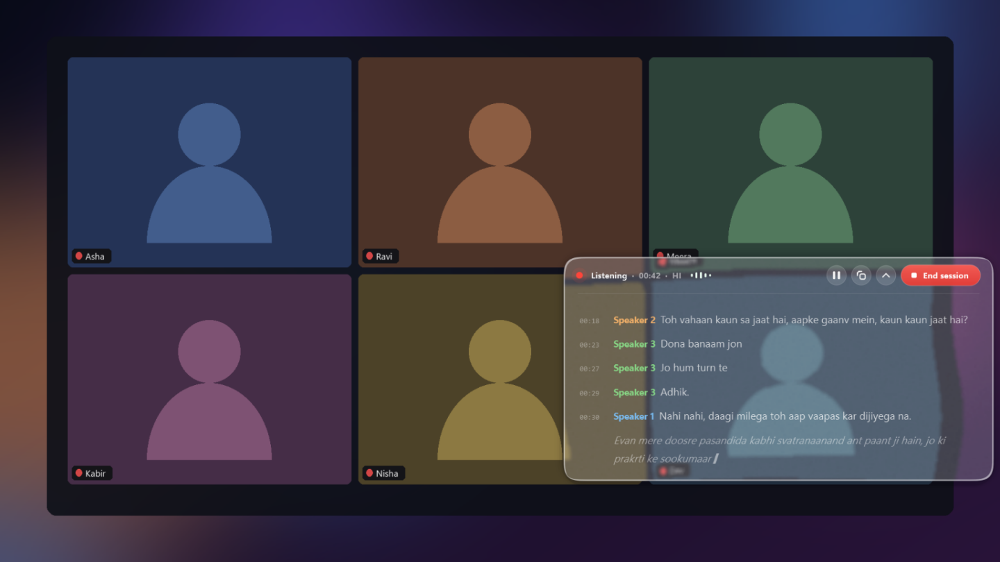<br><b>Dropped at an edge, it docks as a slim bar</b></td>
<td>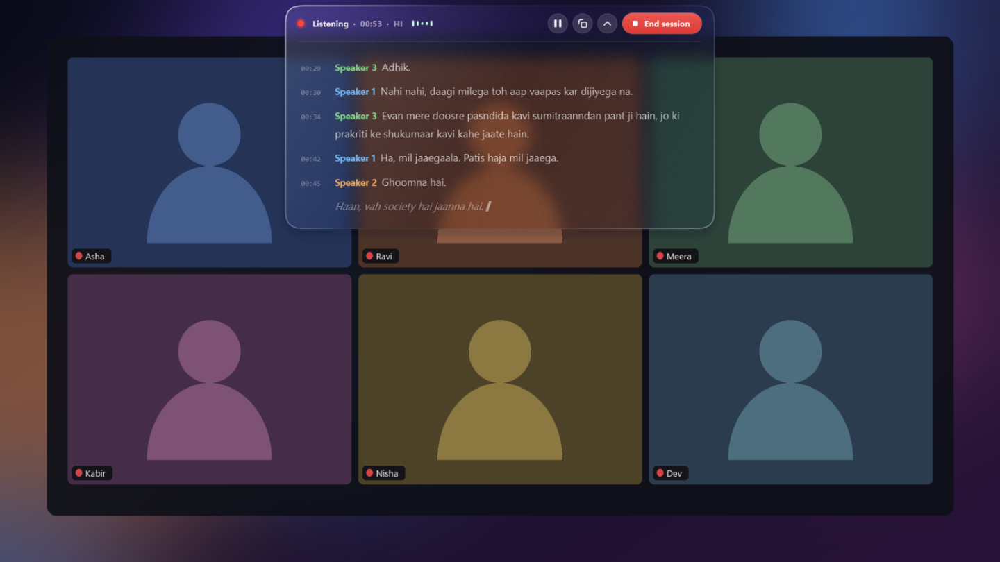<br><b>Frost glass, blurring what is behind it</b></td>
</tr>
<tr>
<td>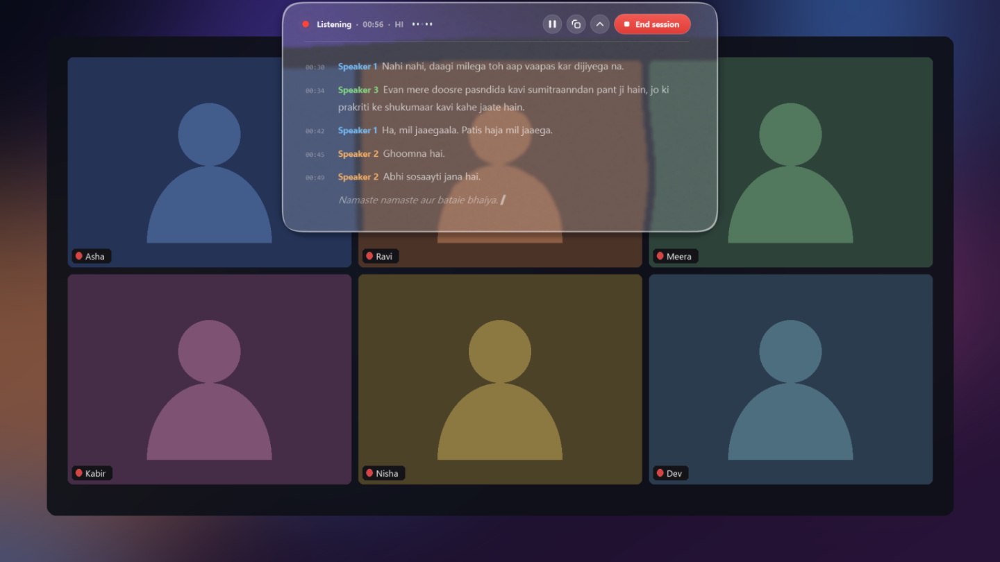<br><b>Liquid glass, with an elastic swell on hover</b></td>
<td>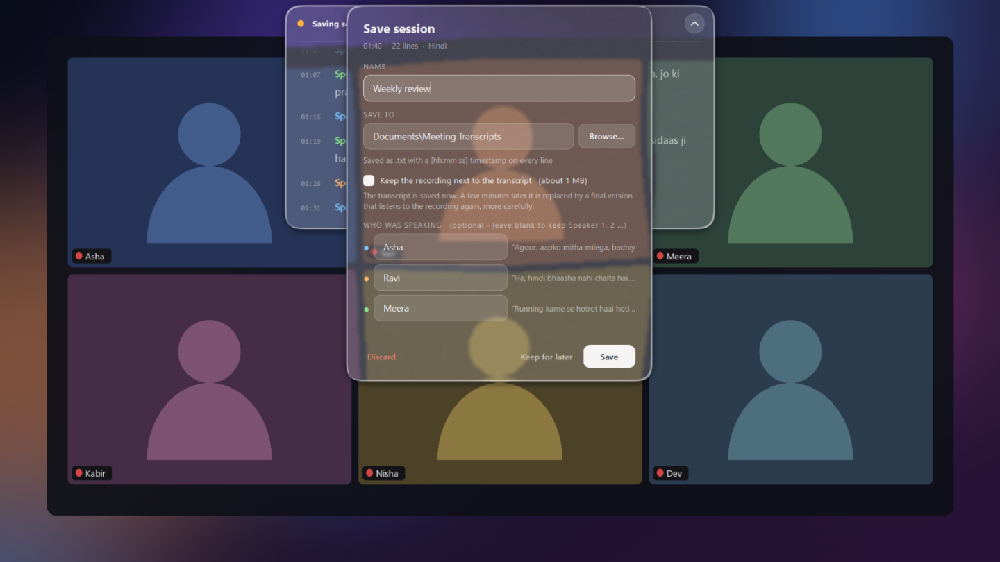<br><b>Save: name, folder, and names for each voice</b></td>
</tr>
<tr>
<td><br><b>The final pass listens to the recording again</b></td>
<td>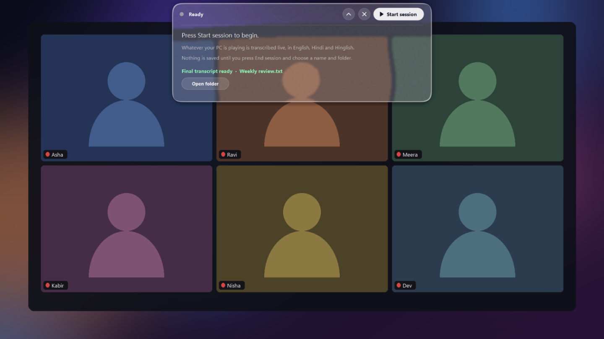<br><b>Final transcript ready, speakers named</b></td>
</tr>
<tr>
<td>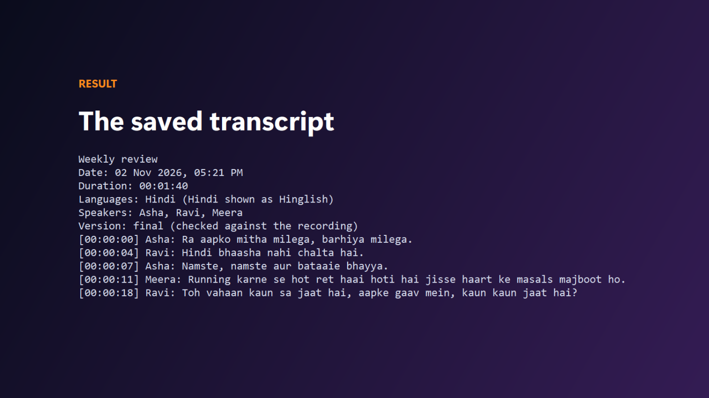<br><b>The saved file: timestamps and who said it</b></td>
<td><br><b>It noticed a fix you made and learned the rule</b></td>
</tr>
<tr>
<td colspan="2" align="center">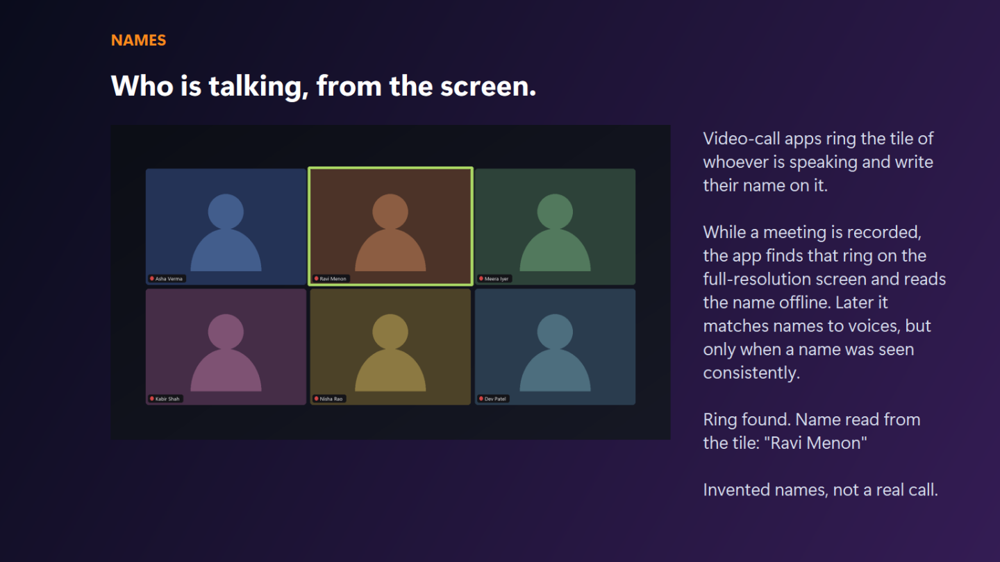<br><b>Names read from the speaking ring on a call screen (made-up call)</b></td>
</tr>
</table>

## Architecture

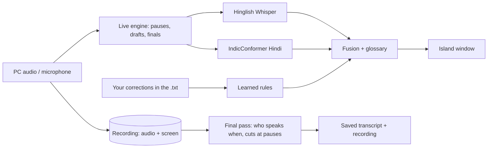

## Run it

Windows 10/11, Python 3.12 or newer.

```bash
python -m venv .venv
.venv\Scripts\pip install -r requirements.txt
.venv\Scripts\python tools/fetch_models.py      # about 330 MB of models, downloaded from their original sources
.venv\Scripts\python island_qt.py               # the island; press Start session
.venv\Scripts\python island_qt.py --sim demo/meeting_demo.wav     # demo mode: plays the included 3-speaker clip instead of the PC audio
```

Useful options: `--mic` (also listen to the microphone), `--collapsed`, `--reset-pos`, `--console` (log to the terminal).
The right-click menu chooses the source, recording, glass look and script (Roman or Devanagari).

## Test

```bash
pip install pytest
pytest tests            # synthetic data only: no models and no private files are needed
```

The test suite covers learning from corrections, the glossary, speaker clustering (including a 2-hour-sized meeting), the speaking-ring
detector and name matching, and where the final pass cuts a recording. `bench/` holds the speech benchmark and the speaker
experiments; they need data that is downloaded by `bench/fetch.py`, not stored here.

## Build the installer and updates

```bash
pip install pyinstaller imageio-ffmpeg pillow
python build_installer.py                 # dist/MeetingIsland-Setup.exe (about 410 MB) and an update against the previous release
python build_installer.py --update-only   # just the small update package
```

Windows' own IExpress and `tar` do the packaging; nothing is downloaded. See `installer/` for the install, update and uninstall scripts.

## Folder layout

| Path | What it is |
|---|---|
| `island_qt.py` | The island: Qt window, glass, springs, menu, Save window |
| `backend.py`, `live.py`, `engine.py`, `assistant.py` | Sessions, the live engine, the speech models, audio capture |
| `fusion.py`, `translit.py`, `glossary.py`, `corrections.py` | Hinglish fusion, Roman script, glossary, learning from edits |
| `speakers.py`, `polish.py`, `finisher.py` | Voice prints, the final pass, background finishing |
| `recorder.py`, `screennames.py` | Screen and audio recording, names from the speaking ring |
| `installer/`, `build_installer.py`, `MeetingIsland.spec` | One-file installer, updater, uninstaller |
| `finetune/` | Fine-tuning the Hinglish model on a free GPU, with a ship/no-ship gate |
| `bench/` | The speech benchmark and speaker experiments, with results in `bench/README.md` |
| `tests/` | The test suite |
| `tools/` | Model download, and `tools/showcase/` which records the film |
| `docs/`, `showcase/` | The story, every feature, screenshots and the tour video |

## Facts

| | |
|---|---|
| Platform | Windows 10/11, runs on a CPU (6 cores, 8 GB is enough) |
| Language / UI | Python, PySide6 (Qt) |
| Speech | Whisper-Hindi2Hinglish-Swift (CTranslate2 int8) + AI4Bharat IndicConformer (ONNX int8) |
| Speakers | NVIDIA TitaNet-small voice prints, pyannote segmentation 3.0 (via sherpa-onnx) |
| Names on screen | Windows built-in text recognition (offline) |
| Hinglish words wrong | about 30% on 80 real clips (spelling-tolerant), 24% in conversation |
| Installer / update | about 410 MB / about 16 MB |
| Tests | `pytest tests` |
| License | MIT |

## Credits

- Demo audio: clips from **IndicVoices** (AI4Bharat), CC BY 4.0, assembled into a three-speaker conversation (`demo/`).
- Models, each under its own licence (check before redistributing): Oriserve/Whisper-Hindi2Hinglish-Swift (Apache-2.0), AI4Bharat
  IndicConformer, NVIDIA TitaNet, pyannote segmentation 3.0.
- Benchmark clips come from the MUCS-2021 and IndicVoices Hinglish sets; fine-tuning uses the public `agarwalayushi/hinglish` dataset.

Copyright (c) 2026 Khushal Vashistha, released under the [MIT License](LICENSE).
